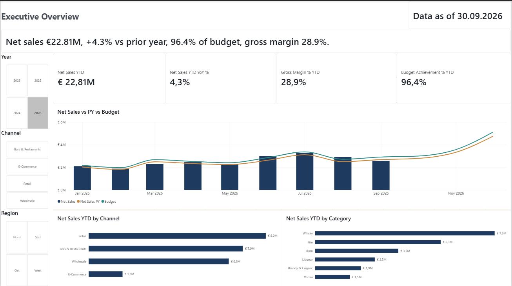
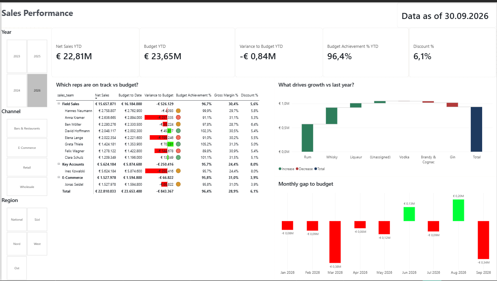
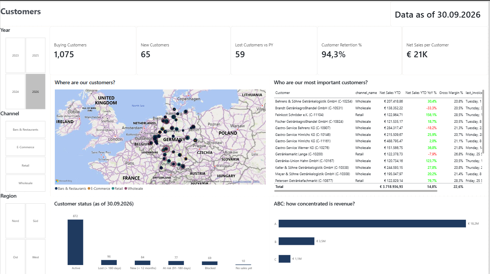
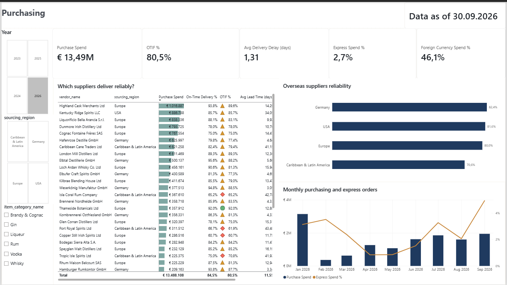
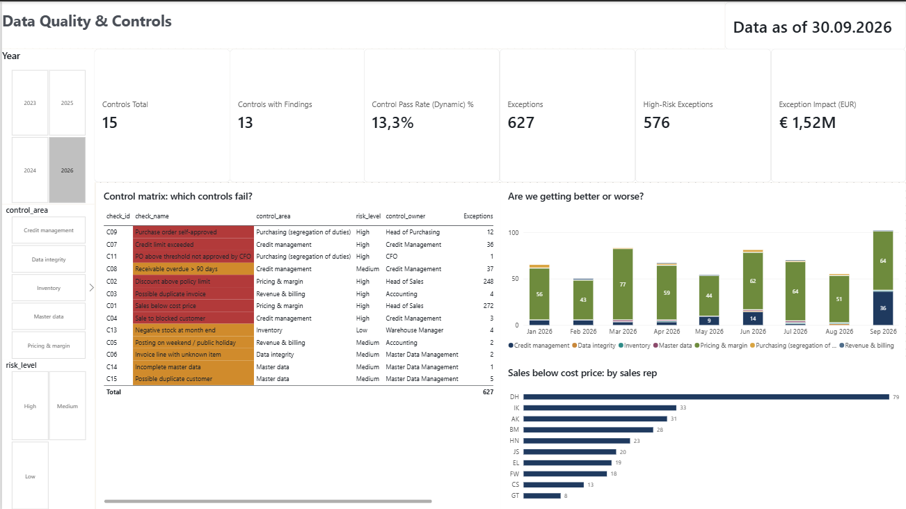
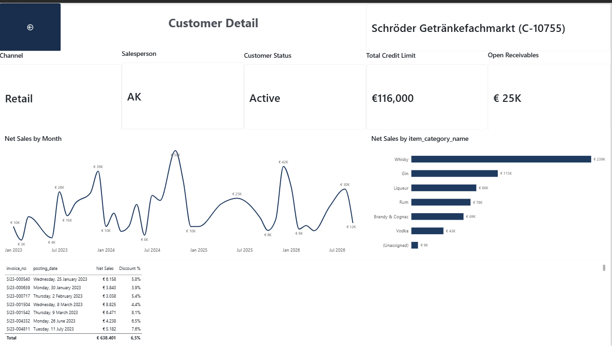
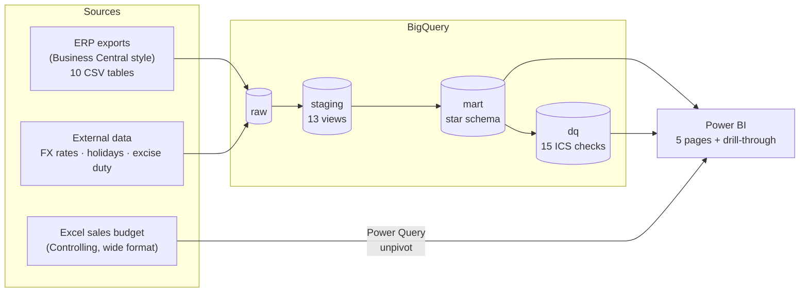
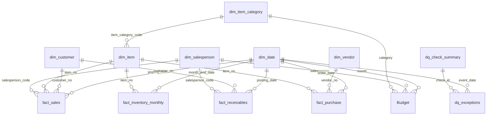

# Spirits Wholesale BI – Sales, Customers, Purchasing & Internal Controls

End-to-end BI solution for a (fictional) spirits wholesaler in Bremen:
**Business Central-style ERP data + Excel budget + external data → Google BigQuery (staging → star schema → data-quality checks) → Power BI.**

> **Business questions:** Are we on track against last year and budget? Which sales reps, customers and categories drive
> the result? How reliable are our suppliers? And can management trust the numbers behind it all?



## Highlights

- **Multi-source integration** – 10 ERP tables modelled on Microsoft Dynamics 365 Business Central (customers, vendors,
  items, sales invoices, purchase orders, item and customer ledger entries), a Controlling sales budget in Excel
  (wide format) and external reference data (EUR exchange rates, Bremen public holidays, German spirits excise duty).
- **Layered data warehouse in BigQuery** – `raw` → `staging` (13 cleaning views) → `mart` (star schema with
  6 dimensions and 4 fact tables) → `dq` (internal controls). Pure SQL, idempotent, rebuilt with one command.
- **15 automated internal controls (ICS)** – sales below cost, discounts above policy, duplicate invoices, deliveries to
  blocked customers, credit-limit breaches, overdue receivables, purchase orders without four-eyes or CFO approval,
  stock adjustments without reason codes, master-data gaps and duplicate customers – each with control owner,
  risk level, frequency and financial impact.
- **Power BI report** – 5 report pages plus a customer drill-through page, built on a star schema with 18 relationships and
  70+ DAX measures (YTD vs prior-YTD for a running year, budget-to-date comparison, customer retention, OTIF,
  dynamic control status).

## Report pages

| # | Page | Answers | Key visuals |
|---|---|---|---|
| 1 | **Executive Overview** | Are we on track vs prior year and budget? | KPI cards (Net Sales YTD, YoY %, Gross Margin %, Budget Achievement %), actual vs PY vs budget by month, sales by channel and category |
| 2 | **Sales Performance** | Which sales reps and categories are on track? | Rep matrix with traffic-light icons and variance bars, waterfall of growth by category, monthly gap to budget |
| 3 | **Customers** | Are we winning or losing customers, and who matters most? | Customer KPIs (new, lost, retention), customer map, top-20 customers, customer status, ABC analysis |
| 3a | *Customer Detail* (drill-through) | What is the history of one customer? | Customer profile, monthly sales, category mix, invoice list |
| 4 | **Purchasing & Suppliers** | Are our suppliers reliable, and what does purchasing cost? | Supplier scorecard with OTIF icons, OTIF by sourcing region, spend and express-order share by month |
| 5 | **Data Quality & Controls** | Can we trust our numbers, and where do processes break? | Control KPIs, control matrix with traffic light, exceptions over time, below-cost sales by rep |

| Executive Overview | Sales Performance |
|---|---|
|  |  |
| **Customers** | **Purchasing & Suppliers** |
|  |  |
| **Data Quality & Controls** | **Customer Detail (drill-through)** |
|  |  |

## Architecture



## Data model



All relationships are many-to-one with single-direction filtering. `report_parameters` (report date and policy
thresholds) is a standalone settings table read directly by the measures.

| Layer | Objects |
|---|---|
| **Dimensions** | `dim_date` (incl. Bremen holidays, business-day flag), `dim_customer` (channel, region, status, ABC class), `dim_item` (category, brand, ABV, price segment, ABC class), `dim_item_category`, `dim_salesperson`, `dim_vendor` (sourcing region, currency) |
| **Facts** | `fact_sales` (invoice line: revenue, discount, cost, margin, litres, excise duty), `fact_purchase` (PO line: spend in EUR at order-date FX, on-time / in-full delivery), `fact_inventory_monthly` (month-end stock, value, days of cover), `fact_receivables` (open amount, days overdue, ageing) |
| **Controls** | `dq_check_summary` (control matrix), `dq_exceptions` (one row per finding) |
| **Budget** | Excel file unpivoted in Power Query: salesperson × item category × month |

## Selected techniques

- **Data cleaning in SQL** – trimming, type casting, NULL handling, normalised name keys for duplicate detection,
  "unknown" dimension members so no fact row is lost.
- **Correct year-to-date logic** – YTD and prior-YTD stop at the last actual date, so a running year (Jan–Sep) is
  compared with the same months of the prior year, not the full year.
- **Budget comparison only where a budget exists** – actuals are compared month by month only for periods that
  have a budget, avoiding inflated variances.
- **FX conversion** – foreign-currency purchases (GBP, USD) converted with the exchange rate of the order date,
  weekends and holidays carried forward.
- **Excise duty** – German spirits tax calculated per litre of pure alcohol and shown as part of the cost of sales.
- **Dynamic control status** – traffic-light colours and pass rates react to the year and area filters.
- **Drill-through** – from the customer list to the full history of a single customer.

## Tech stack

Python (pandas, numpy) · Google BigQuery (SQL, Sandbox) · Power BI Desktop (Power Query M, DAX, TMDL) · Excel · Git

## Repository structure

```
├── generator/            Python data generator (+ optional real ECB rates download)
├── data/
│   ├── erp/              ERP exports (generated, not committed)
│   ├── external/         FX rates, holidays, excise duty
│   └── excel/            Sales budget (Controlling file)
├── bigquery/
│   ├── schemas/          Column types for each raw table
│   ├── sql/01_staging/   Cleaning views
│   ├── sql/02_mart/      Star schema
│   ├── sql/03_dq/        Internal control checks
│   ├── build_all.sql     All SQL as one script (for the BigQuery console)
│   ├── load_to_bigquery.py
│   └── run_sql.py
└── powerbi/
    ├── Spirits_Wholesale_BI.pbix
    ├── measures.dax      DAX measures
    ├── power_query/      M scripts (Excel budget unpivot, BigQuery template)
    ├── theme_hanse_spirits.json
    └── screenshots/
```

## Reproduce

```bash
pip install -r requirements.txt                          # or: uv pip install -r requirements.txt
python generator/generate_data.py                        # create the data (fixed seed)
gcloud auth application-default login                    # one-time Google login
python bigquery/load_to_bigquery.py --project <GCP_ID>   # load the raw layer
python bigquery/run_sql.py --project <GCP_ID>            # build staging, mart and dq
```

Then open `powerbi/Spirits_Wholesale_BI.pbix`, point the BigQuery connection to your project and the `BudgetFilePath`
parameter to the Excel file, and refresh.

The free BigQuery Sandbox is sufficient (the whole project uses well under 1 GB). Sandbox tables expire after 60 days;
re-run the last two commands to rebuild them.

## About the data

All data is synthetic and generated with a fixed seed. The company "Hanse Spirits Trading GmbH", its customers,
vendors, brands and employees are fictional. The generator models realistic patterns – seasonality (Christmas peak,
summer gin and rum), annual price increases, FX effects on imported goods, customer churn and supplier delays – and
deliberately plants data-quality and control issues so the internal controls have something to detect.

## Summary

This project shows the full path from raw operational data to decision-ready reporting: integrating ERP, Excel and
external sources, modelling them into a clean star schema in BigQuery, and presenting sales, customer and purchasing
performance in an interactive Power BI report. Built-in internal controls make data quality and process compliance
measurable, so the report not only shows what happened, but also how far the underlying numbers can be trusted.